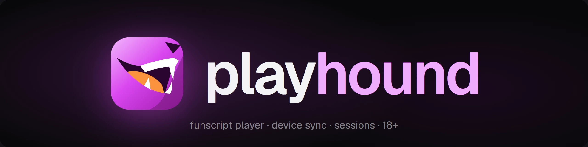
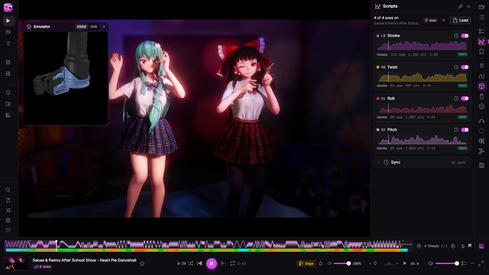

<p align="center">
  <picture>
    <source media="(prefers-color-scheme: light)" srcset="docs/header-dark.webp">
    
  </picture>
</p>

<p align="center">
  <a href="https://github.com/whatmekota/playhound/releases/latest"></a>
  <a href="https://github.com/whatmekota/playhound/releases"></a>
  <a href="LICENSE"></a>
  <a href="https://github.com/whatmekota/playhound/actions/workflows/test.yml"></a>
  <a href="https://whatmekota.github.io/playhound/"></a>
  <a href="https://discuss.eroscripts.com/t/playhound-audiovisual-session-engine-yet-another-funscript-player/345390"></a>
  <!-- <a href="https://boosty.to/whatmekota/donate"></a> -->
  <a href="#safety"></a>
</p>

A funscript video player and audiovisual session engine for your own library and
your own hardware: OSR2/SR6 strokers over TCode, the Handy over WiFi or
Bluetooth, Intiface/Buttplug toys, and an on-screen emulator when nothing is
plugged in.

It plays your videos with their scripts, finds the good parts, follows the music
when there's no script, and can run a whole session by itself, with binaural
audio, a hypnotic overlay, a heart-rate monitor and a phone in your other hand
as the remote.

I built this for myself initially. I wanted my own player, I had a few
half-finished pet projects lying around (binaural beats with visuals, and a
little CYD screen with eyes), and at some point I mixed them all into one big
app with the help of an AI. It has grown big enough that it might be useful to
someone else, so here it is.

<p align="center">
  <a href="https://whatmekota.github.io/playhound/"></a>
</p>

> [!WARNING]
> **18+ only.** playhound is made for adult content and drives physical
> devices. Read [Safety](#safety) before connecting hardware.

## Try it now, no install

**[Open playhound in your browser](https://whatmekota.github.io/playhound/)** (Chrome, Edge or another
Chromium browser), then:

1. Click **Open a folder** and pick a folder of videos with their funscripts,
   or drop one video and its script onto the page.
2. Open the **Emulator** (the cube in the right rail) to watch what a stroker
   would do, and the **Motion** panel to see the rate and the sources.
3. Press **E** to edge, **G** to jump to the next peak, **?** for every key and
   **Ctrl+K** for everything else.

Your videos stay on your computer: the page reads them in place and nothing is
uploaded. Like it? [Get the Windows app](https://github.com/whatmekota/playhound/releases) for the full thing
([what's different](#three-ways-to-run-it)).

---

## Highlights

- **Plays scripts properly.** Multi-axis funscripts (`.pitch`, `.roll`, `.twist`,
  `.surge`, `.sway`, …) are matched to videos automatically. You get latency
  calibration, a per-video script offset, A–B loops and speed control, and a
  timeline that shows the script's intensity, chapters, bookmarks and your past
  edges and finishes.
- **The Handy, built in.** Connect over WiFi with the key from the Handy app, or
  straight over Bluetooth with no internet at all. The script is streamed a few
  seconds ahead and the Handy plays it on its own clock, kept in step with the
  video, so fast scripts play as written, and edges and the intensity knob
  still apply.
- **Edit scripts in the app.** Per-video tweaks that never touch the file:
  range, invert, a speed limit, smoothing and the offset. A point editor under
  the video: click, box-select, drag a whole selection, nudge with the arrows,
  undo, and save back next to the video (the original is kept as a `.bak`).
  **Shift+I** fills between two points with strokes (the generator's own
  shapes, a ramp from one speed to another, or on the soundtrack's beats),
  previewed before it goes in. Save a selection as a pattern and drop it in
  again, stretched or repeated; a few classics come built in.
- **Record a session as a script.** **Shift+C** records what the device does,
  whatever drives it (manual, music, a programme, a plugin), and saves it as a
  `.funscript`, timed to the video if one was playing.
- **Share cards.** A picture of a script to post with it: the strokes
  themselves coloured by speed (playhound's own scale, or funscript.io's,
  OpenFunScripter's or EroScripts'), a row per extra axis, chapters, length,
  actions and speeds, a still from the video behind it, and one big picture or
  four picked from a timeline. Three looks (Forum, Candy, Poster), banner or
  tall; copy it or save it next to the video. The share button is on every
  scripted video in the library.
- **Subtitles and tags.** `.srt`, `.vtt` and `.ass` files next to a video are
  picked up (**V** turns them on). Tag videos yourself, or filter by the tags
  playhound works out from the scripts: pace, intensity, length, multi-axis, VR.
- **Scripted audio.** ASMR, JOI audio or music with a funscript: `Track.mp3`
  pairs with `Track.funscript` (and `.roll`, `.srt`, …) just like a video, in
  mp3, m4a, aac, ogg, opus, flac or wav. Audio files without a script stay out
  of the library. While a track plays, the stage shows your slideshow (it can
  turn on the track's own beat), your media wall (muted), the hypno overlay, or
  the track's cover, and its subtitles show as captions.
- **Pop-out player.** **O** puts the video in a small window that stays on
  top of other apps, with the device still in sync. In the desktop app it can
  be made see-through and let clicks pass to the window underneath, so it can
  sit over a game.
- **VR too.** Side-by-side VR plays in a look-around view: 180°, 190° and 200°,
  equirectangular or fisheye.
- **No script? Use the music.** It finds the beat in the video's soundtrack and
  strokes in time with it, or writes a real `.funscript` from the whole track
  that you can save and edit. Depth can follow how loud the music is or stay at
  the deepest, and strokes can centre where you set or start at the bottom.
  MP4, MOV and M4A files over 1 GB or an hour are read in pieces, so any size
  up to six hours works; other formats up to an hour and 1.5 GB. If it hears the beat wrong,
  tap it in with **T**, even with no video at all: tap along to anything and
  the device follows.
- **Stays in control.** **E** edges: everything backs off for a while and eases
  back in. An intensity knob scales every source. **G** jumps to the next
  peak and **Shift+G** to the most intense part. **Esc** is panic.
- **Programmes.** Plan a session in phases (warm-up, build, edges, peak,
  cool-down). playhound then picks chapters across your library to match the
  plan and plays them as a highlight reel.
- **Session engine.** It can also run without a video: a binaural tone
  generator with noise, a breathing hypno overlay, a free-form media wall
  (local files and YouTube) and a beat-synced slideshow, all moving through
  phases together.
- **Body in the loop.** A Bluetooth heart-rate monitor can call an edge for you
  when your rate climbs fast. Vibrators get a strength worked out from the
  script, the music or the session.
- **Rules.** Automation without writing a plugin: "heart rate over 130 during
  Build → edge", "after 20 minutes → intensity +10%", "on finish → cool down
  and pause". Triggers are things the app really sees (heart rate, phases,
  minutes in, videos and chapters, edges, finishes, intensity, the script's
  pace, tags); actions go through the same controls as your keys. Each rule
  has a cooldown, there is a cap on firings a minute, and panic stops them all.
- **Insights.** Stats says what your history adds up to: time to a finish and
  how it is trending, whether edging makes sessions longer, which scripts and
  tags end in a finish, what ends a session, your heart rate at edges and
  finishes. Each finding says how many sessions it rests on, and stays hidden
  until there are enough.
- **Streams straight from the post.** Pixeldrain, Gofile, MEGA, Iwara,
  Rule34Video and PMVHaven links play without downloading anything first, with
  seeking and a quality choice; Pornhub, XVideos, Hanime1, rule34.xyz and many
  more go through yt-dlp, which playhound fetches for you if you want it. Or
  download the video with its scripts, named so the library pairs them.
- **Remotes.** Use a phone over Wi-Fi (big buttons, panic in the thumb zone), a
  gamepad, or an [ESP32 "Cheap Yellow Display"](firmware/cyd-face) face that
  watches the session and reacts. The face also comes as Kerfus, the cat robot,
  and can fill a second monitor instead of a board.
- **Plugins.** Extra features from a plugin store (GitHub repositories you
  follow) or a zip. Each says what it needs before you install it, and can add
  a panel, a full page, commands and shortcuts. The official ones:
  - [playmate](https://github.com/whatmekota/playmate): an AI partner that
    talks, moves the device and can run a whole session.
  - [ph2gether](https://github.com/whatmekota/ph2gether): together mode. Two
    people, each with their own playhound and device, watch and play in sync
    over the internet, with a chat for swapping links. The apps connect
    directly, encrypted; five emojis to compare out loud show that nobody is
    in between. Partners can hand each other the controls (edges, intensity,
    what plays), with consent and within each side's own limits.
  - [phbrowser](https://github.com/whatmekota/phbrowser): a web browser on
    playhound's stage, so tap tempo and generated motion keep going while you
    browse (desktop app).
  - [phthreads](https://github.com/whatmekota/phthreads): finds the EroScripts
    threads of your library's videos, with their tags and newer versions.
  - [phbeatbar](https://github.com/whatmekota/phbeatbar): a Cock Hero-style
    beat bar over the video, to follow the script by hand.
  - [phstash](https://github.com/whatmekota/phstash): your Stash collection in
    the library, streamed with its funscripts, tags and markers.
  - [phvr](https://github.com/whatmekota/phvr): follow a video playing in
    HereSphere or DeoVR and drive your devices from playhound, and browse your
    library from the headset (desktop app; new, reports welcome).

  Writing one is described in [docs/plugins.md](docs/plugins.md), including a
  dev mode that reloads your plugin as you save.

- **Desktop app.** For Windows, macOS and Linux. It keeps driving the device
  while minimised, remembers your library folder, updates itself (Windows and
  Linux), and can show Discord Rich Presence (off by default).

## Getting started

### Three ways to run it

|                                                             | [Browser](https://whatmekota.github.io/playhound/) | [Windows app](https://github.com/whatmekota/playhound/releases) | From source |
| ----------------------------------------------------------- | :------------------------------------------------: | :-------------------------------------------------------------: | :---------: |
| Your library, the player, programmes, the session engine    |                         ✓                          |                                ✓                                |      ✓      |
| TCode devices (Web Serial), heart-rate monitors (Bluetooth) |                         ✓                          |                                ✓                                |      ✓      |
| TCode over the network: WebSocket                           |                         ✓‡                         |                                ✓                                |      ✓      |
| TCode over the network: UDP                                 |                                                    |                                ✓                                |             |
| E-stim audio (experimental)                                 |                         ✓                          |                                ✓                                |      ✓      |
| Intiface / Buttplug toys                                    |                        ✓\*                         |                                ✓                                |      ✓      |
| The Handy, over WiFi or Bluetooth                           |                         ✓                          |                                ✓                                |     ✓†      |
| EroScripts browser, phone remote, CYD face                  |                                                    |                                ✓                                |      ✓      |
| Streaming from file hosts and yt-dlp sites                  |                                                    |                                ✓                                |      ✓      |
| Kerfus face on a second monitor                             |                         ✓                          |                                ✓                                |      ✓      |
| Remembers your library folder without a click               |                                                    |                                ✓                                |             |
| Keeps driving the device while minimised                    |                                                    |                                ✓                                |             |
| Discord Rich Presence                                       |                                                    |                                ✓                                |             |

\*With Intiface Central running on the same computer; not yet tested from the
hosted page.

†Over WiFi, needs a Handy application ID (free, from the
[Handy developer portal](https://user.handyfeeling.com)) in `.env.local` as
`VITE_HANDY_APP_ID`, or pasted under the Handy tab's **Advanced**. Bluetooth
needs nothing.

‡From the hosted page, only to this computer (restim): a page served over
https may not open a plain `ws://` link to another device. The desktop app and
`pnpm dev` can.

Bluetooth in the browser needs Chrome or Edge.

- **Browser:** nothing to install, a good way to see if you like it. Your
  library, settings and stats are kept by that browser; **Backup → Export**
  moves them to the Windows app later.
- **Windows app:** the installer or the portable .exe from
  [Releases](https://github.com/whatmekota/playhound/releases). Then skip to [Using it](#using-it).
- **macOS and Linux app:** the `.dmg` or `.AppImage` from the same page; see
  [installing on macOS and Linux](docs/install-mac-linux.md) for the first launch.
- **From source:** for other systems, or to change things. Read on.

### From source

You need **Node 22+**, **pnpm 10** and a **Chromium-based browser** (Chrome,
Edge, Brave…). playhound relies on the File System Access API to read your
library and on Web Serial to talk to TCode devices.

```bash
git clone https://github.com/whatmekota/playhound
cd playhound
pnpm install
pnpm dev            # http://localhost:6969
```

Open the app, pick your video folder, and it pairs each video (or audio file)
with its scripts by file name (`Video.mp4` + `Video.funscript` +
`Video.roll.funscript` …).
Nothing is copied or uploaded; the folder is read in place. A script can also
be loaded by hand from the **Scripts** panel; on Android the picker shows every
file (it does not know the `.funscript` type), and anything that is not a
`.funscript` is turned away.

On Windows, `start.bat` starts everything at once: the app, the
EroScripts proxy (`:7071`) and the remote relay (`:7072`). If you've built the
desktop app, it launches that instead.

### Desktop app (Windows)

Building it yourself:

```bash
pnpm app            # Electron window on the dev server, with hot reload
pnpm app:build      # installer + portable .exe in release/
pnpm app:dir        # unpacked build only (quicker)
```

The desktop app is the same code served the same way. It runs the proxy and the
remote relay in-process and serves the app on your LAN so the phone can reach
it. It also:

- remembers the library folder without the browser's "reconnect" click
- skips the serial-port chooser when there's only one port
- keeps running at full speed while hidden

It keeps its own profile in `%APPDATA%\playhound`. To bring your browser data
over, use **Backup → Export** in the browser and **Import** in the app.

The build is unsigned, so SmartScreen asks once. Allow the firewall prompt on
private networks, or the phone remote can't connect.

## Using it

### Devices

Open the **Device** panel (**D**):

| Output                   | How                                                                                                                                                                                                                                                                                                                                                                                                                                                                                                                                     |
| ------------------------ | --------------------------------------------------------------------------------------------------------------------------------------------------------------------------------------------------------------------------------------------------------------------------------------------------------------------------------------------------------------------------------------------------------------------------------------------------------------------------------------------------------------------------------------- |
| **TCode** (OSR2, SR6, …) | Over USB (Web Serial) or the network: a WebSocket, or UDP in the desktop app, for ESP32 builds on WiFi ([TCode ESP32](https://github.com/jcfain/TCodeESP32)) and for [restim](https://github.com/diglet48/restim). Set each axis's range, inversion and resting position, and save presets. A network link that drops reconnects by itself.                                                                                                                                                                                             |
| **Intiface / Buttplug**  | Connect to Intiface Central. Strokers get linear moves, from scripts and from the motion generator; vibrators, rotators and oscillators get a strength from the source you pick per toy.                                                                                                                                                                                                                                                                                                                                                |
| **The Handy**            | Firmware 4, over WiFi (paste the connection key from the Handy app) or straight over Bluetooth (no internet, no key). playhound streams the stroke script a few seconds ahead and the Handy plays it on its own clock, kept in step with the video, so fast scripts play as written, and the intensity knob and edges still apply. The motion generator (music, tap tempo, gamepad) drives it live. Under Advanced: **Live**, every move sent as it happens like MultiFunPlayer, and, over WiFi, **Whole script** for slow connections. |
| **E-stim audio**         | Experimental and new: the signal is checked against restim's maths, but not yet on many boxes, so reports are welcome. The stroke as a stereo tone on a sound output of its own, for a stim box with an audio input: restim's three-phase signal, or two channels panned. Off every time the app starts; it starts silent and fades in. Read [Safety](#e-stim-audio) first.                                                                                                                                                             |
| **Emulator**             | A 3D OSR on screen, for trying things with nothing plugged in.                                                                                                                                                                                                                                                                                                                                                                                                                                                                          |

**Connecting the Handy** (firmware 4) in the Device panel's **Handy** tab:

- **WiFi:** paste the connection key from the Handy app and click **Connect to
  the Handy**. It goes through Handy's server, so it needs internet.
- **Bluetooth:** click **Connect to the Handy** and pick it from the list. No key
  and no internet. Close the Handy app's Bluetooth connection first, since only
  one program can hold it. In a browser, Bluetooth needs Chrome or Edge.

Then play anything with a stroke script. The Handy has its own **Sync offset**,
separate from latency calibration.

**TCode over the network**, in the **TCode** tab under **Network**: pick a
target and connect. Commands are the same as over USB, with all the axes of
one update on one line.

| Target                | Address                      | Notes                                                                                      |
| --------------------- | ---------------------------- | ------------------------------------------------------------------------------------------ |
| ESP32 OSR (UDP)       | `tcode.local:8000`           | TCode ESP32 firmware on WiFi. Desktop app only. Use the board's IP if `tcode.local` fails. |
| ESP32 OSR (WebSocket) | `ws://tcode.local/ws`        | The same firmware through its web server, for the browser.                                 |
| restim (WebSocket)    | `ws://localhost:12346/tcode` | restim reads L0 as alpha, L1 as beta and V0 as volume.                                     |
| restim (UDP)          | `localhost:12347`            | Desktop app only.                                                                          |
| Custom                | any host and port            | WebSocket or UDP.                                                                          |

For restim, set the stroke axis (L0) to 0–100% under **Axes**, or restim never
reaches the ends. Panic also presses **Stop** in restim (through its own
control port, 12348), since restim would otherwise keep stimulating where the
stroke stopped.

**Latency calibration** lines the device up with the picture. A **per-video
offset** fixes scripts that are a little early or late.

### Motion sources

Exactly one source drives the device at a time, and you can switch live in the
**Motion** panel:

| Source  | Strokes from                                                                                              |
| ------- | --------------------------------------------------------------------------------------------------------- |
| Script  | the loaded funscript, synced to the video                                                                 |
| Music   | the beat of the video's soundtrack: phase-locked, with half-time and double-time picked to suit the tempo |
| Session | the session's phase and intensity                                                                         |
| Beat    | the binaural beat, divided down to a usable rate                                                          |
| Pulse   | the audible session pulse                                                                                 |
| Manual  | the rate and depth sliders (also what a plugin drives)                                                    |

A loaded script always wins while it plays, so a generator never fights video
sync for the same axis.

The **speed ceiling** under Safety limits caps every generated stroke. It goes
up to 240 spm; past that it needs an explicit opt-in (up to 400), because most
strokers can't keep up there. Stroke shapes: sine, ease, pulse, saw (a steady
push and a quick drop) and sharp (even speed with hard turns).

**Record** (Motion panel, Shift+C or the palette) saves what the device does as
a funscript, whatever drives it: a generator, a plugin, a script under the
intensity knob and edges. With a video playing it is timed to the video (only
playing time counts; seek back and you record over that part) and saved beside
it, as `<video>.funscript` or, if that exists, `<video>.recorded.funscript`.
Without one it is `session-YYYY-MM-DD-HHMM.funscript` in the library folder.
One file per axis that moved.

### Keyboard

Press **?** in the app for the full list and **Ctrl+K** for the command palette.
The ones you'll use most:

| Key              | Does                                                |
| ---------------- | --------------------------------------------------- |
| Space · ← → · F  | play/pause · seek 5 s · fullscreen                  |
| **O**            | pop-out player, on top of other windows             |
| N · P · R        | next · previous · random scripted video             |
| , · .            | previous / next chapter of the script               |
| **E** · Shift+E  | edge (back everything off) · "I'm OK", end the hold |
| **-** · **=**    | intensity down / up                                 |
| **G** · Shift+G  | next peak · jump to the finish                      |
| **C**            | I came: marks it on the video and in Stats          |
| Shift+C          | record what the device does · stop and save         |
| **T** · Shift+T  | tap tempo for the Music source · forget it          |
| **V** · Shift+V  | subtitles on/off · next subtitle track              |
| B · S            | bookmark here · star the video                      |
| **Esc** or **`** | **panic**: stop everything and cover the screen     |

### The EroScripts browser

The **EroScripts** view browses the forum's Free Scripts from inside the app, and
turns a post into something you can play: its video, its scripts, together.

**Browsing.** Latest, Top and Hot, filtered by tag, or search; as a grid of
covers or a compact list. Star a post to keep it under **Saved**, with your
own data (Backup carries it), and come back to it later.

**Signing in.** The forum only shows Free Scripts to members. In the Windows
app, **Sign in** opens the forum's own login page in a window of the app, and
playhound keeps a session of its own, refreshed the way a browser refreshes
it, so it stays signed in and never logs your browser out. From source, paste
your browser's `_t` cookie instead (the dialog shows where to find it): it is
kept on this computer and only sent to the forum through the local proxy, but
it is your browser's session, and the forum replaces it often, so expect to
paste it again now and then. The Android app signs in like the Windows app:
the forum's login page opens inside the app, and the session stays in the
app's private storage.

**A post** shows its scripts with the axis each one drives (`L0`, `R1`…).
Save any of them, or load one onto whatever is playing.
Scripts inside a Pixeldrain folder are found too. Its video links are resolved
as soon as it opens: pick a video (a folder can hold several) and a quality,
then:

- **Play with N scripts** (or **Play + scripts** on one source) streams the
  video with the post's scripts loaded. Their names don't have to match the
  video's, which on file hosts they rarely do: each script's axis is read from
  its siblings (`Song.roll` next to `Song`), and a post with several videos
  gives each one the set whose name fits it best.
- **Download** saves the video and those scripts into your library folder (or
  a folder you pick once), all under the video's name, so the library pairs
  them the moment they land: `Name.mp4`, `Name.funscript`,
  `Name.roll.funscript`. Nothing is overwritten: a name that is taken gets
  ` (2)`. HLS sources (some Pornhub videos) can play but not be saved yet.

Anywhere else, **Ctrl+K → Play a link…** takes any link you paste.

| Host                                                   | Tried and working | How                                                                                                                                             |
| ------------------------------------------------------ | :---------------: | ----------------------------------------------------------------------------------------------------------------------------------------------- |
| Pixeldrain, Gofile, MEGA, Iwara, Rule34Video, PMVHaven |         ✓         | playhound's own resolvers; MEGA is decrypted as it streams                                                                                      |
| Pornhub, XVideos, Hanime1, rule34.xyz                  |         ✓         | [yt-dlp](https://github.com/yt-dlp/yt-dlp): the first time a link needs it, playhound offers to fetch the official release and keeps it updated |
| Many more sites yt-dlp supports                        |                   | yt-dlp                                                                                                                                          |
| X                                                      |                   | yt-dlp, but age-restricted posts only show video to logged-in users                                                                             |
| rule34.xxx, Bunkr                                      |         ✗         | rule34.xxx sits behind a Cloudflare check, and yt-dlp has no Bunkr support                                                                      |

Everything goes through the small local proxy the Windows app runs (or
`start.bat` / `pnpm dev:proxy` from source). The Android app needs no proxy:
it makes the same requests itself, and resolves Pixeldrain, Gofile, MEGA,
Iwara, Rule34Video and PMVHaven on the phone; yt-dlp sites need the desktop
app. If the forum or one of these sites
is blocked where you are, put an HTTP proxy in **Settings → Network**: the
forum, streaming and yt-dlp all go through it. Left empty, playhound uses
`HTTPS_PROXY` from your system if it is set. Anonymous MEGA has a transfer
quota per connection.

### Phone remote

Open the **Remote** panel and open the link it gives you on your phone. The
link carries your computer's LAN address, so the phone must be on the same
Wi-Fi. The phone gets play/pause, next/previous, edge, intensity and a big panic button,
and can keep its screen awake.

### The face (optional)

A little screen for the desk that watches the session: it changes mood as
things heat up, follows the strokes with its eyes, shows edges and their
countdown, and hides a control bar (edge, previous, play/pause, next, random,
panic) behind a tap.

It runs on an **ESP32-2432S028R** ("Cheap Yellow Display", about $10–15; the
micro-USB and USB-C versions both work) and needs 2.4GHz Wi-Fi on the same
network as the computer. For a case and stand, print [the original
model](https://www.thingiverse.com/thing:6310957) (micro-USB board) or [its USB-C remix](https://www.thingiverse.com/thing:6406058) (no lid).

Building it takes the Arduino IDE, four libraries and a short config file; the
steps are in [firmware/cyd-face](firmware/cyd-face/README.md#building-it). Then
switch on the **Remote** panel and **Drive the face** in the **Face** panel.

The board has two faces, the original anime eyes and [Kerfus](firmware/cyd-face/README.md#kerfus),
the cat robot. No board? **Face** panel → **Open face window** (or Ctrl+K →
_Open face window_) shows Kerfus in a window of its own. The desktop app puts
it full screen on your second display, and it needs no relay or setup.

### Around the app

- **Left nav:** Player, Library, Playlists, Media Wall, Slideshow,
  EroScripts, Organizer, Stats, and a button for each plugin that has a page.
- **Right rail:** Queue, Scripts, Bookmarks, Device, Motion, Programme, Rules,
  Remote, Face, Binaural, Hypno, Director, Backup, and a button for each plugin
  that has a panel. Middle-click a panel icon to pin it.
- **Rules:** one trigger, any conditions (all must hold), one or more actions
  and a cooldown each. Five starters come switched off. **Try it now** runs a
  rule's actions straight away, and the panel logs the last 50 firings with
  the reason. Intensity changes ramp at about 5% a second; nothing a rule does
  can pass the speed ceiling or turn generated motion on, and a rule never
  answers an event its own action caused. Rules are in Backup.
- **Plugins:** Settings → Plugins installs them from the store or a zip and
  holds their settings. The install screen lists what a plugin asks for;
  official plugins (by whatmekota) carry a check mark. A plugin still runs
  inside playhound, so install only ones you trust.
- **Library:** one folder or several (a collection split across drives),
  search (`tag:name` and `type:audio` too), filter chips and tags, sort by folder, script intensity and speed sparklines,
  hover-scrub previews, and an **auto-director** that picks the next video
  to suit the moment (and, if you switch it on, leans towards videos you
  finish to). Audio files with a script are listed with an **Audio**
  badge and chip, and their embedded cover (or a picture of the script) as the
  thumbnail. The buttons at the top of the player pick what plays on the stage
  with them: **Slideshow**, **Media wall**, **Hypno** or **Cover**.
- **Organizer:** rename a video and all its scripts and subtitles together,
  keeping the axis suffixes and language tags.
- **EroScripts:** browse Free Scripts, play a post's video with its scripts,
  download both under one name, save posts for later (see
  [The EroScripts browser](#the-eroscripts-browser)).
- **Stats:** watch time, plays, finishes and edges, per video and per day, and
  Insights: this week against the last, time to finish, edging and session
  length, finishes by script intensity and by tag, what ends a session, time
  of day and weekday, heart rate and script pace at a finish. Sessions (start,
  end, edges, finishes, heart rate and pace at those moments) are logged from
  2.2 on, so those findings start then; the rest use everything recorded. A
  session ends after half an hour with nothing playing.
- **Themes:** dark, light, Catppuccin and Dracula, plus a choice of logos.
  In the desktop app, **Interface size** makes everything up to twice as big,
  for a screen across the room.

## Safety

playhound moves real hardware, so generated motion is bounded:

- **Speed ceiling.** There's a hard strokes-per-minute limit that nothing can
  exceed.
- **Ramping.** Rate and depth ramp instead of jumping, so a phase change eases
  in over a few seconds.
- **Phase accumulation.** Phase is accumulated rather than recomputed, so a
  change of rate never makes the position jump.
- **Clamped frame delta.** A tab that comes back from the background doesn't
  lurch.
- **Stopping.** Depth eases to zero and the axes go home.
- **Coming back.** For most of a second after a TCode link comes up (or comes
  back after a network drop), every move is stretched, so the device glides to
  where the motion is instead of jumping there.
- **Panic** (Esc or `) stops every output at once and covers the screen. Press
  it again to resume. It works from the keyboard, the phone and the gamepad.
- **Rules** can only do what your own controls do, never pass the speed
  ceiling and never switch generated motion on. Nothing fires during a panic,
  and after it a rule has to see its trigger happen again.

The motion maths lives in `src/lib/motionMath.ts`, `src/lib/edging.ts` and
`src/lib/musicMotion.ts`, and is covered by unit tests. Still, test new
settings with the emulator or at low range first.

### E-stim audio

**Experimental and new.** The signal is checked against restim's own maths
(carrier, three-phase balance, panning, fades, limits, panic), but it hasn't
been on many boxes yet: tell us how it works with yours. 18+. Use it only through a
stim box made for audio input, never wired straight to a headphone jack.
Never above the waist or across the chest, never with a pacemaker or a heart
condition. Turn the box down before you start and raise it slowly.

- **Off at every launch.** You press **Start** each time. The volume, its
  limit and the output are remembered; being on is not.
- **Starts silent.** Every start fades in from silence over at least five
  seconds, and the volume never rises faster than 10% of full scale a second.
- **A limit you set.** Nothing goes above it, whatever drives the stroke.
- **Fades out fast** (under half a second) on pause, stop, or when nothing
  moves the stroke. The intensity knob and edges turn it down too.
- **Panic** cuts it to silence at once, and it stays off until you press
  Start again. Unplugging its output does the same.
- **Its own output.** It refuses the system's default output, where the
  video's sound goes.
- **A dead man's switch.** If the page stops updating it, it fades out by
  itself.

The signal and the volume rules live in `src/lib/estim.ts`, with tests.

## Privacy

Everything stays on your machine: library, scripts, stats, playlists, settings.
There are no accounts, analytics or telemetry. The app talks to the outside
world only when you use a feature that needs it:

- the **EroScripts** browser and its download hosts
- **YouTube** tiles on the media wall
- **the Handy over WiFi**: commands go through Handy's server with your
  connection key, and **Whole script** uploads the shaped script to Handy's
  script hosting. Over Bluetooth nothing leaves your computer.
- **ph2gether** (plugin): your app and your partner's connect directly; public
  relays only help them find each other and never see what you watch. Your
  partner sees your IP address.
- **phbrowser** (plugin): the sites you visit, in a browsing session of its own.
- **TCode over the network**: commands go to the address you enter (your
  stroker on your WiFi, or restim on this computer), and nowhere else.
- **Discord Rich Presence**: desktop app only, off by default. Its Minimal mode
  shows the app and a timer, never what's playing; titles appear only if you
  write a custom template that asks for them.

The phone remote and the CYD face talk to your own computer over your LAN.

## Development

```bash
pnpm dev            # app on :6969 (with --host, for the phone)
pnpm dev:proxy      # EroScripts proxy + remote relay, if not using start.bat
pnpm test           # Vitest
pnpm typecheck      # vue-tsc
pnpm lint           # ESLint (@antfu/eslint-config); runs on commit too
```

**Stack:** Vue 3.5, Vite 7, Pinia, vue-router (file-based), UnoCSS
(`presetWind4`), Vitest, Electron 44 for the desktop build. Scaffolded from
[vitesse-lite](https://github.com/antfu-collective/vitesse-lite).

```text
src/
  components/   ui/ primitives · shell/ · player/ · views/ · inspectors/ (right-rail panels)
  composables/  device links, engines, sync loops (useVideoSync, useMotionEngine, …)
  stores/       Pinia: playback, queue, library, device, motion, session control, …
  lib/          pure logic, unit-tested: parsing, motion maths, beat tracking, programmes
  workers/      soundtrack decoding (MP4 in pieces) and analysis off the main thread
  pages/        / (the app) and /remote (the phone)
desktop/        Electron main process, preload, packaging
firmware/       ESP32 CYD face (Arduino); protocol in docs/face-protocol.md
es-proxy.mjs    EroScripts CORS proxy (:7071) and remote relay (:7072)
test/           Vitest suites
```

### Android app (in progress)

A Capacitor shell in `android/` around the same build: library folders
through Android's folder picker (`src/lib/android/`, and the Kotlin plugins in
`android/app/src/main/java/…/`), playback with scripts, the Handy over WiFi,
TCode over WebSocket, a phone layout, the EroScripts browser and file-host
streaming, and the devices (Bluetooth, USB OTG and the session service, below).
Settings → Android app on the phone lists what is not in it yet and
checks its WebView.

There is no Node on the phone, so what `es-proxy.mjs` does on the desktop is
native there. One loopback server on `127.0.0.1` (random port, every path
behind a random token only the page learns) serves:

- `f`: files in picked folders, with byte ranges (`folders/MediaServer.kt`);
- `p`: a CORS-free fetch with any headers, redirects followed, optionally
  with the app's cookie store (the forum session), through the proxy from
  Settings → Network if one is set. The page's `nativeFetch`
  (`src/lib/android/net.ts`) goes through it, and the resolvers of
  `server/hosts.mjs` run in the page on top of it (`src/lib/android/hosts.ts`,
  kept in step by hand);
- `m`: streams registered with their headers, for `<video>` (Range passed
  on, HLS playlists rewritten, MEGA files decrypted with AES-CTR from any
  byte, `net/NetRoutes.kt`);
- `w`: writes into picked folders, PUT in pieces of a few MB, so saving next
  to a video, downloads from posts and the Organizer's renames work as they
  do with the browser's folder handles (`AndroidTree` in
  `src/lib/android/folders.ts`).

EroScripts sign-in is the forum's login page in a WebView activity
(`net/ForumLoginActivity.kt`); its `_t` cookie stays in the WebView's cookie
store, in the app's private storage.

Plugins: their `fetch` goes through `p` too. Plugins that ask for `web`, `socket` or `serve` need the desktop app; the store says so and the Android app will not install them.

It needs JDK 21 and the Android SDK (platform 36, build-tools 36). The scripts
expect them in one folder, `F:\tools\android` (`jdk-21\`, `sdk\`), or wherever
`PH_ANDROID_TOOLS` points, and keep Gradle's and Android's caches there too;
`android\env.cmd` (or `env.ps1`) sets the same up for a shell.

```bash
pnpm mobile:apk      # vite build, cap sync, debug APK → release/android/playhound-debug.apk
pnpm mobile:release  # signed release APK → release/android/playhound-<version>-android.apk
pnpm mobile:install  # adb install the debug APK on the phone (USB debugging on)
pnpm mobile:test     # the Kotlin plugin's JVM tests
pnpm mobile:icons    # launcher icons and splash from public/favicon.svg
pnpm mobile:dev      # dev server on :7140 for live reload, then:
CAP_SERVER_URL=http://<this PC>:7140 pnpm mobile:sync   # and reinstall
```

Debug builds are signed with the toolchain folder's debug key. Release builds
are signed with a key that never goes in the repo: `android/app/build.gradle`
takes it from `PH_KEYSTORE`, `PH_KEYSTORE_PASSWORD`, `PH_KEY_ALIAS` and
`PH_KEY_PASSWORD`, or from a `keystore.properties` named by
`PH_KEYSTORE_PROPERTIES` (`storeFile`, relative to it, `storePassword`,
`keyAlias`, `keyPassword`); `pnpm mobile:release` uses
`<toolchain>keyskeystore.properties` when nothing else is set. versionName
and versionCode come from package.json (2.2.0 → 2002000). Keep the key safe:
every later release has to be signed with it, or Android refuses the update.
A release build cannot update a debug build (another key): uninstall the debug
one first, once.

**Updates.** The app looks at this repository's GitHub Releases on launch
and once a day for a newer release with an asset named
`playhound-<version>-android.apk` (what `pnpm mobile:release` builds), shows
its notes, and on **Update** downloads it into the app's cache, checks its
SHA-256 against the one GitHub lists, and opens Android's installer (the
first time Android asks to allow installing from playhound). A debug build is
told to install the release by hand instead.

The phone layout (`useCompactLayout`: a bottom bar upright, a rail on the left
sideways, `CompactDock` for the player) can be styled in a desktop browser:
`pnpm mobile:dev`, then open `http://localhost:7140/?phone` with the browser's
device toolbar (`?phone=0` turns it off). Only the layout changes; files and
devices stay the browser's.

Crashes: the app keeps a journal in its private storage (`…/crash/`: Java
crashes, the WebView's renderer crashing or being killed for memory, which the
app recovers from by starting the page again, what Android says ended the last
run) and the page's last errors. After a bad end it shows "playhound closed
unexpectedly last time" with **Copy report**; Settings → Android app → Copy
report has the same. With the phone on USB, `adb logcat -d > log.txt` has the rest.

Devices: the WebView has neither Web Bluetooth nor Web Serial, so the app puts
its own on `navigator` before the page loads (`src/lib/android/shims.ts`), and
`handyBle`, `useHeartRate` and `useSerialPort` run unchanged. Bluetooth goes
through `@capacitor-community/bluetooth-le` (`android/ble.ts`), USB OTG serial
through usb-serial-for-android (MIT) in `…/usb/UsbSerialPlugin.kt`
(`android/serial.ts`); both choosers are the app's own sheet
(`AndroidDevices.vue`), which asks for "Nearby devices" in plain words first.
Intiface Central stays on the PC, reached over Wi-Fi at `ws://<PC>:12345`.
While anything is connected or plays, a `mediaPlayback` foreground service
(`…/session/`) keeps the page running with the screen off (its WebView,
`PhWebView`, does not tell the page it went out of sight), holds a wake lock
while playing and a Wi-Fi lock for network devices, and its notification has
Panic (as Esc) and Open; closing the app from the recent apps panics first, and
the USB port is sent home from the native side too.

Conventions that keep it in one piece:

- **`playbackStore` is the only way to change what plays.** The library, queue,
  hotkeys, gamepad, phone and programmes all go through it, so they agree on
  what's next.
- **Every `localStorage` key is registered** in `src/lib/persist.ts`, with
  migrations between schema versions. A test fails if one isn't.
- **Hotkeys live in `src/lib/hotkeys.ts`.** The cheat sheet renders from that
  list, so a key can't exist without being documented.
- **Logic that can be pure goes in `src/lib/`** and gets tests. Components and
  composables wire it to the clock, the DOM and the devices.
- **UI uses the primitives in `src/components/ui/`** and the theme tokens in
  `src/styles/main.css`.

## Status

This is a personal project, built for and tested on one setup (Windows, Chrome,
an OSR2). Forum testers have since run the Handy on real hardware: a Handy 2
over WiFi and Bluetooth, and a Handy 1 over WiFi. The macOS app has been tried
on an Apple silicon Mac; the Linux app is built but untested. Still waiting on
real hardware:

- the Handy's Live mode and generated motion over WiFi (fixed in 1.4.0, not yet
  confirmed)
- vibrators through Intiface, and the Handy through Intiface
- an ESP32 OSR build over the network, new in 2.2 (restim has been checked:
  it follows playhound over WebSocket and UDP)
- e-stim audio on a real stim box, new in 2.2: the signal is checked against
  restim's own maths, but how it feels is up to you
- the phvr plugin on a real headset (HereSphere, DeoVR); it was tested
  against a stand-in

Reports and fixes are welcome.

## License

[MIT](LICENSE)
